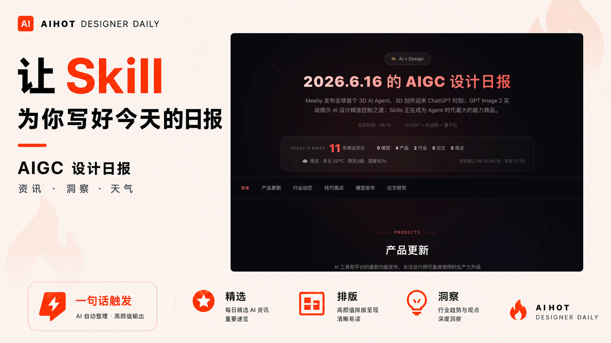

# AIGC Daily for Designers

为 UI/UX 设计师、产品经理和创意工作者生成高质量 AIGC 设计日报的 Skill。

它会自动精选 AI 产品、模型发布、行业动态、设计趋势和方法观点，并输出一个高颜值、可分享的单文件 HTML 日报。适合每天晨会、团队分享、设计灵感收集和个人知识管理。



## Why This Skill

普通 AI 新闻太杂，设计师真正关心的是：

- 哪些 AI 产品会改变设计流程
- 哪些模型能力值得马上试用
- 哪些行业趋势会影响 UI/UX、产品体验和内容生产
- 今天有什么值得分享给团队的重点

这个 Skill 会把信息筛成设计师能直接消化的日报，并用更像真实产品页面的方式呈现出来。

## What It Generates

- 单文件 HTML 设计日报
- 产品更新、行业动态、技巧观点、模型发布、论文研究等分类
- 每条资讯包含摘要和“设计师看点”
- 自带保定天气和日报统计信息
- QClaw 暗色主题：红色强调、玻璃态卡片、动效背景、清晰信息层级

## Quick Start

在 WorkBuddy、Trae Solo、Claude 或支持 Skills 的 AI 工具里安装后，直接输入：

```text
帮我生成今天的 UIUX 设计师 AIGC 日报
```

也可以使用：

```text
设计师晨报
设计日报
AIGC design daily report
```

## Install

下载本仓库中的 `aigc-daily-for-designers.zip`，然后让 AI 帮你安装：

```text
请帮我安装 aigc-daily-for-designers 技能
```

手动安装也可以：

1. 解压 `aigc-daily-for-designers.zip`
2. 将 `aihot-designer-daily` 文件夹复制到你的 Skills 目录
3. 重启或刷新你的 AI 工具技能列表

## Repository Contents

```text
aihot-designer-daily/
  SKILL.md
  assets/
    dashboard-template.html

example-2026-06-16.html
使用指南.md
aigc-daily-for-designers.zip
cover.png
```

## Example

打开 `example-2026-06-16.html` 可以查看生成效果。

## Good For

- UI/UX 设计师
- 产品经理
- AIGC 创作者
- 设计团队负责人
- 需要每天快速了解 AI 设计趋势的人

## Keywords

`AIGC` `AI Daily` `UIUX` `Product Design` `Designer Tools` `AI News` `HTML Dashboard` `Codex Skill` `WorkBuddy Skill`

